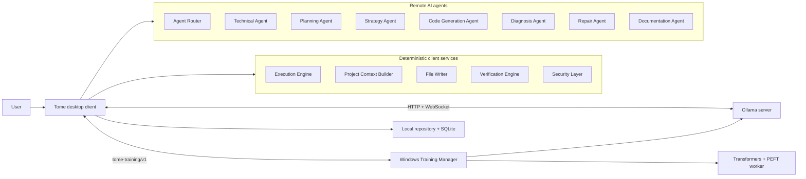

# Tome

Tome is a cross-platform, AI-powered desktop software-engineering workspace. The desktop
client keeps repositories and deterministic execution on the user's machine while
delegating all AI reasoning to agents hosted by an Ollama server.

This repository contains the production-ready project foundation and functional desktop
shell. Navigation, project-owned chat trees, local records, settings, server management,
Ollama model management, streaming chat, history, task progress, and diagnostic logging
are operational. Dataset validation, resumable upload sessions, training job
orchestration, monitoring, resources, and logs are implemented against the bundled Windows
Training Manager. Its real Transformers + PEFT worker supports LoRA and QLoRA, while
training remains opt-in and executes only on the configured Windows server. AI agents,
code generation, repair, and deterministic execution workflows remain intentionally
deferred.

## Architecture at a glance



AI agents reason and produce structured proposals. Only deterministic client services can
read repositories, execute commands, verify results, or write files. Potentially
destructive operations must pass through the security layer.

## Technology

- Tauri v2 and Rust
- React 19, strict TypeScript, and Vite
- Tailwind CSS and shadcn/ui conventions
- Zustand and TanStack Query
- React Router, React Hook Form, and Zod
- react-markdown, Mermaid, Monaco Editor, xterm.js, Recharts, and Sonner
- SQLite for local persistence
- Official Ollama REST API with streamed NDJSON responses

## Getting started

Prerequisites:

- Node.js 22+
- pnpm 10+
- Rust stable
- The platform prerequisites listed in the
  [Tauri documentation](https://v2.tauri.app/start/prerequisites/)

```bash
pnpm install
pnpm desktop dev
```

Useful checks:

```bash
pnpm lint
pnpm typecheck
pnpm test
pnpm build
pnpm format:check
pnpm rust:check
```

The architecture summary, open decisions, repository map, and staged delivery plan are in
[`docs/`](docs/).

The external training protocol, upload state machine, monitoring behavior, and security
boundary are documented in
[`docs/architecture/training-management.md`](docs/architecture/training-management.md).
Windows installation and diagnostics are documented in
[`services/training-manager/README.md`](services/training-manager/README.md).

## Supported release targets

- Windows: `.exe`, `.msi`
- macOS (Intel and Apple Silicon): `.app`, `.dmg`
- Linux: `.deb`, `.rpm`, `.AppImage`

Local unsigned packages can be built with:

```bash
pnpm desktop build --bundles app,dmg --no-sign
```

Signing, notarization, updater, and release-channel decisions remain open production
release concerns.
