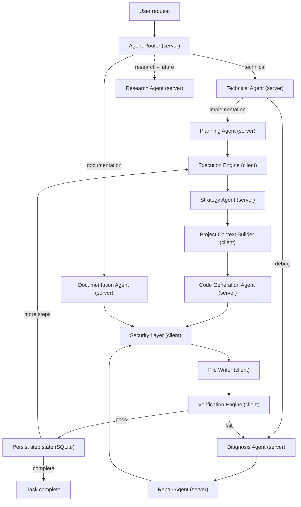
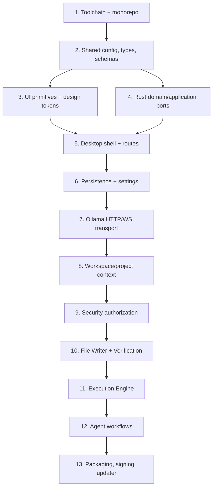
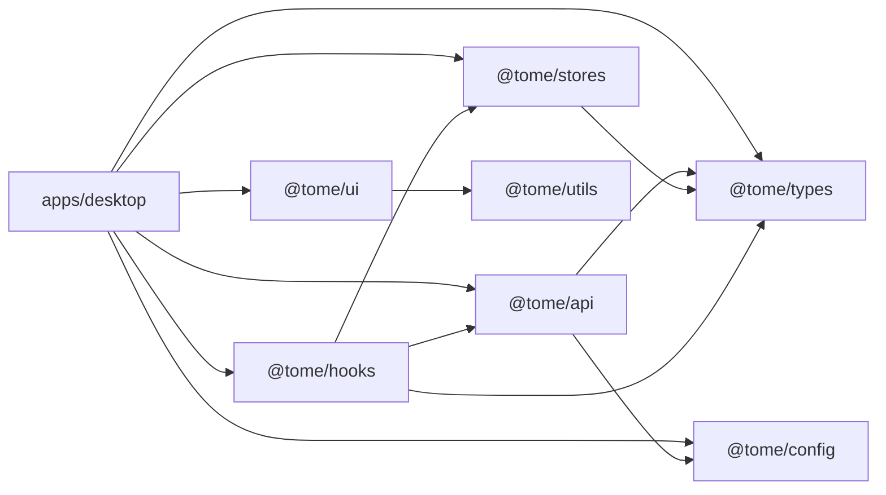

# Implementation Dependency Graph

## Runtime graph

## Build-order graph

## Package dependencies

Dependencies flow inward toward stable contracts. Feature packages may consume
shared packages, but shared packages may not import application features.

