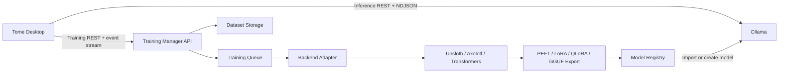
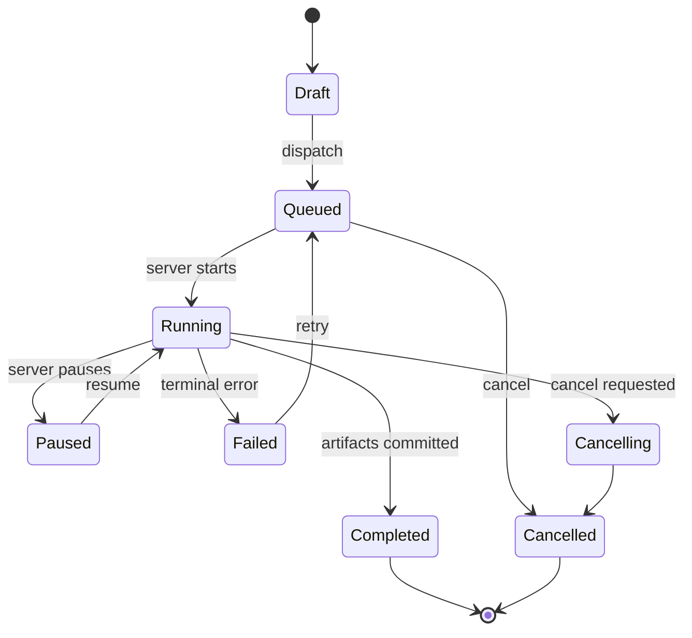

# Tome Training Management Architecture

Status: Windows Training Manager implementation baseline Last reviewed: 2026-07-28

## Decision

Tome keeps inference and training as separate systems:



Ollama remains the inference and model-runtime boundary. Tome does not patch Ollama and
does not perform training inside the desktop process. A training server may run on the
same machine only when the user explicitly configures its URL.

## Ollama capability investigation

The official Ollama documentation index and OpenAPI specification were reviewed on
2026-07-27:

- <https://docs.ollama.com/llms.txt>
- <https://docs.ollama.com/openapi.yaml>
- <https://github.com/ollama/ollama/blob/main/docs/api.md>
- <https://docs.ollama.com/import>

The published API provides inference, embeddings, model creation/import, copy, pull, push,
delete, inspection, and runtime status. It does not publish endpoints for dataset upload,
fine-tuning, training jobs, epochs, loss, ETA, training progress, or training resource
monitoring.

Therefore Tome uses a backend-neutral external training protocol. Ollama integration
begins only after a backend exports a compatible model artifact. The official
`/api/create` endpoint or the local `ollama create` command performs registry creation;
neither performs fine-tuning.

## Windows AI Server deployment

The machine at `192.168.1.6` hosts two independent processes:

```text
Ollama                    http://0.0.0.0:11434
Tome Training Manager     http://0.0.0.0:11435
```

The Training Manager is a Rust service in `services/training-manager`. It owns a separate
SQLite database and data root and runs as a Windows service. It never writes inside
Ollama's storage directory.

```text
%PROGRAMDATA%\Tome\TrainingManager\
├── config.json
├── training-manager.sqlite3
├── datasets\
├── uploads\
├── jobs\
│   └── <job-id>\
│       ├── specification.json
│       ├── checkpoints\
│       └── output\
└── workers\
```

The default listener becomes LAN-accessible only when the deployment script creates an
explicit Windows Firewall rule for TCP 11435. Bearer-token authentication is supported and
should be enabled before exposure beyond a trusted network.

## Desktop responsibilities

The desktop owns:

- project/chat organization and local metadata;
- dataset cataloging, validation, optional ZIP compression, checksums, and previews;
- resumable upload coordination and persisted transfer state;
- training job drafts, dispatch, cancellation, retry, and history;
- polling/heartbeat fallback, resource snapshots, ETA estimation, and logs;
- permission checks before upload, dispatch, cancellation, deletion, or registry import.

The desktop never owns:

- gradient computation;
- dataset transformation beyond validation/compression;
- framework processes;
- GPU allocation;
- checkpoints;
- model conversion or quantization execution;
- training secrets in SQLite.

## Training Manager protocol

The first adapter targets `tome-training/v1`. Future adapters implement the same desktop
port and may translate to Unsloth, Axolotl, Hugging Face Transformers, PEFT, LoRA, QLoRA,
llama.cpp conversion, or a managed service.

### Discovery and health

| Method | Path               | Purpose                                              |
| ------ | ------------------ | ---------------------------------------------------- |
| `GET`  | `/v1/capabilities` | Protocol version, supported formats/backends, limits |
| `GET`  | `/v1/health`       | Liveness and server version                          |
| `GET`  | `/v1/resources`    | GPU, CPU, RAM, disk, and queue state                 |
| `GET`  | `/v1/events/ws`    | WebSocket job, log, resource, and registry events    |

### Resumable datasets

| Method   | Path                              | Purpose                            |
| -------- | --------------------------------- | ---------------------------------- |
| `POST`   | `/v1/uploads`                     | Create or resume an upload session |
| `GET`    | `/v1/uploads/{id}`                | Read acknowledged byte offset      |
| `PUT`    | `/v1/uploads/{id}/chunks/{index}` | Upload a byte range                |
| `POST`   | `/v1/uploads/{id}/complete`       | Validate and register the dataset  |
| `DELETE` | `/v1/uploads/{id}`                | Cancel an upload session           |
| `DELETE` | `/v1/datasets/{id}`               | Remove a committed remote dataset  |

Every chunk includes `Content-Range`, `X-Content-SHA256`, and an idempotency key. The
server response returns the next acknowledged offset. Tome persists that offset after each
accepted chunk, retries transient failures with bounded backoff, and resumes from the
server-confirmed offset after restart.

Completion is a long-running server operation because it verifies the full checksum,
extracts archives, validates records, and commits metadata. Training Manager 0.1.3 and
later own that work in a background task and return `202 Accepted`; Tome polls the
persisted `validating`, `completed`, or `failed` state every five seconds. The desktop
retains a one-hour compatibility timeout for older synchronous servers and emits
validation heartbeats instead of applying the short timeout used for ordinary API calls.

Dataset registration is idempotent by dataset ID. If a retry creates a new resumable
upload session for a dataset already registered on the Training Manager, completion
updates the existing dataset metadata and source upload reference instead of failing a
primary-key constraint.

### Jobs and monitoring

| Method | Path                                | Purpose                                |
| ------ | ----------------------------------- | -------------------------------------- |
| `POST` | `/v1/jobs`                          | Dispatch a validated job specification |
| `GET`  | `/v1/jobs`                          | Reconcile active and historical jobs   |
| `GET`  | `/v1/jobs/{id}`                     | Heartbeat/status snapshot              |
| `POST` | `/v1/jobs/{id}/cancel`              | Request cancellation                   |
| `POST` | `/v1/jobs/{id}/retry`               | Retry with the immutable specification |
| `GET`  | `/v1/jobs/{id}/logs?after={cursor}` | Incremental logs                       |
| `GET`  | `/v1/events/ws`                     | Preferred WebSocket event stream       |

Tome prefers WebSocket server events and immediately reconciles the corresponding
persisted job after an event. When WebSocket streaming is unavailable, active jobs poll
every five seconds. A job becomes `unreachable` after three missed heartbeats but is not
marked failed without a server terminal state.

## Backend, export, and registry adapters

The queue invokes a backend through a stable server-side port:

```text
TrainingBackend
├── validate(specification, dataset)
├── prepare(job_directory)
├── run(progress_sink, cancellation)
└── collect_artifacts()
```

The first executable adapter is the bundled Hugging Face Transformers + PEFT worker. It
supports LoRA and QLoRA when the matching Python and CUDA dependencies are installed.
Unsloth and Axolotl are capability names but remain unavailable until their adapters are
installed on the Windows host; the API reports this instead of simulating progress.

Exports pass through a separate model-export port:

- PEFT Safetensors adapter;
- merged Safetensors model;
- GGUF conversion through configured llama.cpp tools.

The registry adapter writes a job-local Modelfile and invokes the local Ollama CLI. On
success it verifies the model through `/api/tags` before emitting `model.registered`.
Registration failure is a terminal job error and retains all output artifacts.

Ollama's published Safetensors adapter-import list currently covers Llama,
Mistral/Mixtral, and Gemma. The Training Manager validates this before queueing so an
unsupported architecture such as Qwen cannot consume training time and fail only during
registration. A future GGUF export adapter is the extension path for other llama.cpp
architectures.

## Job state model



Training parameters are stored as versioned JSON plus normalized summary fields. A job may
reference one or more datasets; `datasetIds` preserves the ordered selection and the
worker combines those datasets into one corpus before tokenization. Every selected dataset
must be valid and registered on the same Training Manager. A job specification is
immutable after dispatch. Retrying creates a new attempt linked to the original job.

Dataset groups are desktop-side organizational containers. A group owns zero or more local
dataset catalog records and provides bulk add, existing-record assignment, upload, and
delete actions. Group deletion explicitly deletes each member first and preserves the
group if any local or remote dataset cannot be removed; the UI reports the blocking
upload, deletion, server, or job-reference reason. Assignment changes only group metadata,
preserving validation, artifacts, and upload state. Selecting a group in the job form
expands it into the current ordered set of valid dataset IDs; the remote Training Manager
protocol remains dataset-based and requires no group-specific coupling. Existing and
intentionally independent datasets remain available under `Ungrouped`.

## ETA estimation

Server-provided ETA is authoritative. Otherwise Tome estimates:

1. Prefer mean seconds per completed epoch when at least one epoch is complete.
2. Otherwise use elapsed time divided by progress.
3. Apply an exponentially weighted moving average to avoid large visual jumps.
4. Display `Calculating` until enough information exists.
5. Never invent progress when the server reports no measurable stage.

## Dataset validation

Supported extensions are configurable and default to:

`jsonl`, `json`, `csv`, `parquet`, `txt`, `md`

Validation is deterministic:

- paths must resolve to a regular file or directory;
- symlinks are not followed;
- hidden files and known build/cache directories are skipped;
- at least one supported file is required;
- JSON and JSONL syntax is checked;
- empty files are rejected;
- total bytes and file count are recorded;
- previews are bounded and never execute content;
- SHA-256 is computed for the upload artifact.

Compression creates an application-managed ZIP artifact without modifying the source.

## Persistence

SQLite stores:

- training servers and capability snapshots;
- dataset groups and nullable dataset-to-group membership;
- datasets and validation results;
- upload sessions and acknowledged offsets;
- job specifications, attempts, status, metrics, and heartbeat timestamps;
- bounded job logs and resource snapshots.
- dataset preparation, upload, validation, and deletion tasks with progress and stage logs
  for the global Task Queue and Context Panel.
- the latest persisted training activity and error details in the right context panel;
  dataset-card “View logs” actions focus this panel without leaving the workflow.
- worker preprocessing emits scanning and record-validation progress before model loading,
  so ETA is available during preparation instead of remaining at zero until the first
  optimizer step.
- per-job telemetry samples the Python worker process tree every two seconds. Job cards
  distinguish worker CPU/RAM and disk I/O from server-wide resource snapshots; an absent
  NVIDIA probe is displayed as “Not detected” rather than `0%`.
- worker failures preserve dataset name, file, record number, available fields, and the
  underlying process status. The right context panel merges these remote job logs with
  dataset upload and server activity logs.

Secrets belong in the platform credential store when authenticated adapters are added.
SQLite stores only a credential reference.

## Security and recovery

- Upload, remote deletion, job dispatch, cancellation, and model import pass through the
  existing Ask/Smart/Full Access policy.
- Local dataset removal deletes Tome metadata and managed compressed artifacts only; it
  never deletes the user's source dataset.
- Remote requests use explicit timeouts and detailed errors.
- Upload and job operations are idempotent and persisted before network mutation.
- On desktop restart, interrupted uploads become resumable `paused` records with their
  acknowledged byte offsets intact. Interrupted local validation or deletion work is
  marked failed with an explicit restart reason because an in-process filesystem worker
  cannot survive application termination.
- Logs redact authorization headers and never include dataset contents.

## UI contract

The Training route contains:

- Dashboard
- Datasets
- Training Jobs
- Running
- Completed
- Failed
- History
- Server Resources
- Logs

The Datasets section renders collapsible group rows with aggregate dataset count, valid
count, storage size, upload state, and group-level actions. Individual dataset controls
remain available inside expanded groups. Group headers use a compact toolbar layout;
expanded datasets are indented beneath their parent with a continuous hierarchy guide.
Completed transfers collapse into a concise registration summary instead of retaining a
full progress panel. Deleting a group first deletes its local dataset records and
Tome-managed artifacts; source files and remote Training Manager copies are not silently
removed.

Empty and unavailable states are explicit. When no training server is configured, users
can still catalog, preview, validate, compress datasets, and create job drafts. Network
actions explain that a compatible external Training Manager must be configured.

Dataset operations expose a continuous stage model:

`Preparing Dataset → Scanning Files → Counting Files → Calculating Total Size → Validating Structure → Compressing → Ready for Upload → Uploading → Server Validation → Dataset Registered`.

Cards report processed and total bytes, current file, transfer speed, remaining bytes,
percentage, and ETA where available. Every dataset owns independent operation state, so
parallel preparation and uploads do not overwrite each other. Validation errors retain
their exact file and parser reason; the card renders a bounded first page to remain
responsive for very large invalid datasets while SQLite retains the complete result.
Delete state is per dataset, disables duplicate actions immediately, and keeps the card
visible with stage feedback until local and remote cleanup succeeds.

Task persistence is serialized per operation so an earlier progress write cannot arrive
after and overwrite a terminal state. On startup, the database migration reconciles legacy
dataset-preparation tasks stranded at 100% with their validated dataset record, marking
them completed or failed as appropriate.

## Operational constraints

- No job starts until a valid dataset upload is committed and the requested backend
  reports available.
- The server executes one GPU job at a time by default; queue concurrency is configurable.
- The desktop never starts a local worker.
- The bundled worker is real, but installation and health checks never start training.
- Framework installation, CUDA compatibility, model licenses, and Hugging Face access are
  operator responsibilities and are reported through capabilities and diagnostics.
- `maxRecords` and `maxSteps` are optional smoke-run controls. They intentionally bound
  dataset records and optimizer steps for end-to-end validation; production training
  should omit them or set values based on a reviewed experiment plan.
