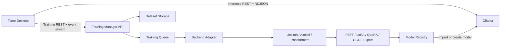
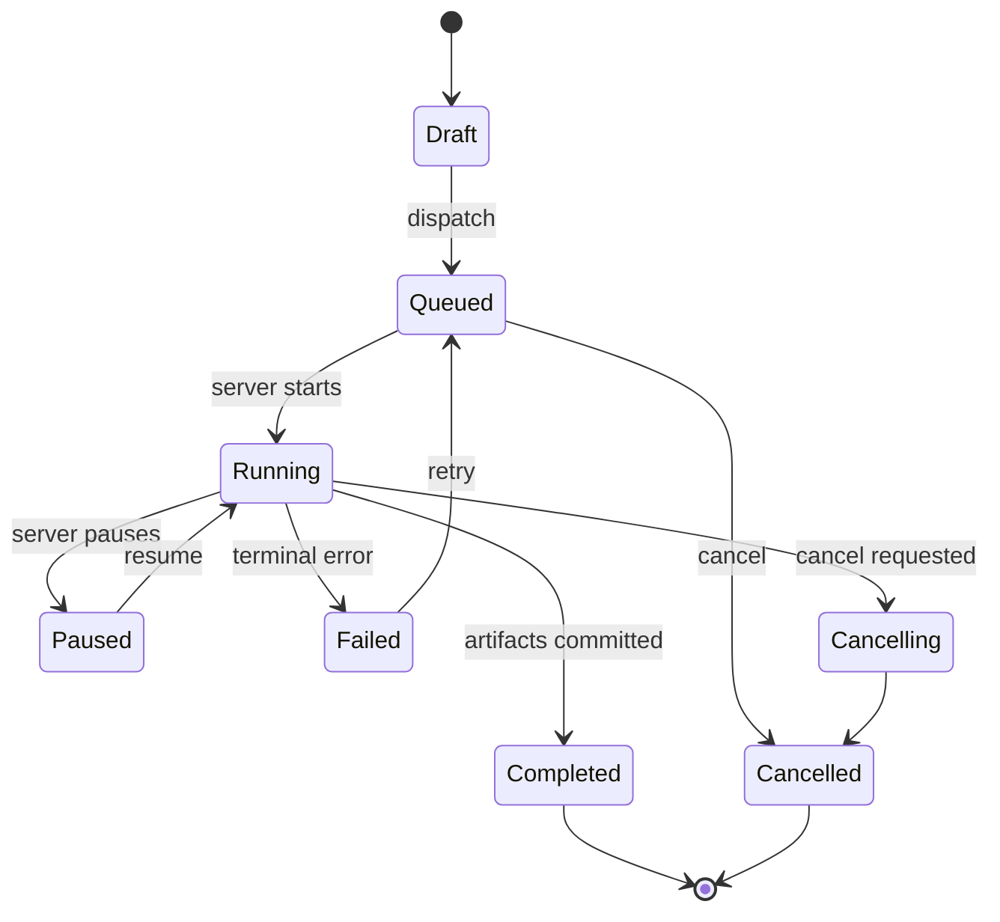

# Tome Training Management Architecture

Status: approved implementation baseline for Prompt 3  
Last reviewed: 2026-07-27

## Decision

Tome keeps inference and training as separate systems:

Ollama remains the inference and model-runtime boundary. Tome does not patch Ollama and
does not perform training inside the desktop process. A training server may run on the
same machine only when the user explicitly configures its URL.

## Ollama capability investigation

The official Ollama documentation index and OpenAPI specification were reviewed on
2026-07-27:

- <https://docs.ollama.com/llms.txt>
- <https://docs.ollama.com/openapi.yaml>
- <https://github.com/ollama/ollama/blob/main/docs/api.md>
- <https://docs.ollama.com/import>

The published API provides inference, embeddings, model creation/import, copy, pull, push,
delete, inspection, and runtime status. It does not publish endpoints for dataset upload,
fine-tuning, training jobs, epochs, loss, ETA, training progress, or training resource
monitoring.

Therefore Tome uses a backend-neutral external training protocol. Ollama integration
begins only after a backend exports a compatible model artifact.

## Desktop responsibilities

The desktop owns:

- project/chat organization and local metadata;
- dataset cataloging, validation, optional ZIP compression, checksums, and previews;
- resumable upload coordination and persisted transfer state;
- training job drafts, dispatch, cancellation, retry, and history;
- polling/heartbeat fallback, resource snapshots, ETA estimation, and logs;
- permission checks before upload, dispatch, cancellation, deletion, or registry import.

The desktop never owns:

- gradient computation;
- dataset transformation beyond validation/compression;
- framework processes;
- GPU allocation;
- checkpoints;
- model conversion or quantization execution;
- training secrets in SQLite.

## Training Manager protocol

The first adapter targets `tome-training/v1`. Future adapters implement the same desktop
port and may translate to Unsloth, Axolotl, Hugging Face Transformers, PEFT, LoRA, QLoRA,
llama.cpp conversion, or a managed service.

### Discovery and health

| Method | Path               | Purpose                                              |
| ------ | ------------------ | ---------------------------------------------------- |
| `GET`  | `/v1/capabilities` | Protocol version, supported formats/backends, limits |
| `GET`  | `/v1/health`       | Liveness and server version                          |
| `GET`  | `/v1/resources`    | GPU, CPU, RAM, disk, and queue state                 |

### Resumable datasets

| Method   | Path                              | Purpose                            |
| -------- | --------------------------------- | ---------------------------------- |
| `POST`   | `/v1/uploads`                     | Create or resume an upload session |
| `GET`    | `/v1/uploads/{id}`                | Read acknowledged byte offset      |
| `PUT`    | `/v1/uploads/{id}/chunks/{index}` | Upload a byte range                |
| `POST`   | `/v1/uploads/{id}/complete`       | Verify checksum and commit dataset |
| `DELETE` | `/v1/uploads/{id}`                | Cancel an upload session           |
| `DELETE` | `/v1/datasets/{id}`               | Remove a committed remote dataset  |

Every chunk includes `Content-Range`, `X-Content-SHA256`, and an idempotency key. The
server response returns the next acknowledged offset. Tome persists that offset after each
accepted chunk, retries transient failures with bounded backoff, and resumes from the
server-confirmed offset after restart.

### Jobs and monitoring

| Method | Path                                | Purpose                                |
| ------ | ----------------------------------- | -------------------------------------- |
| `POST` | `/v1/jobs`                          | Dispatch a validated job specification |
| `GET`  | `/v1/jobs`                          | Reconcile active and historical jobs   |
| `GET`  | `/v1/jobs/{id}`                     | Heartbeat/status snapshot              |
| `POST` | `/v1/jobs/{id}/cancel`              | Request cancellation                   |
| `POST` | `/v1/jobs/{id}/retry`               | Retry with the immutable specification |
| `GET`  | `/v1/jobs/{id}/logs?after={cursor}` | Incremental logs                       |
| `GET`  | `/v1/events`                        | Optional server-sent event stream      |

Tome prefers server events. When the adapter reports no event capability, active jobs poll
every five seconds. A job becomes `unreachable` after three missed heartbeats but is not
marked failed without a server terminal state.

## Job state model

Training parameters are stored as versioned JSON plus normalized summary fields. A job
specification is immutable after dispatch. Retrying creates a new attempt linked to the
original job.

## ETA estimation

Server-provided ETA is authoritative. Otherwise Tome estimates:

1. Prefer mean seconds per completed epoch when at least one epoch is complete.
2. Otherwise use elapsed time divided by progress.
3. Apply an exponentially weighted moving average to avoid large visual jumps.
4. Display `Calculating` until enough information exists.
5. Never invent progress when the server reports no measurable stage.

## Dataset validation

Supported extensions are configurable and default to:

`jsonl`, `json`, `csv`, `parquet`, `txt`, `md`

Validation is deterministic:

- paths must resolve to a regular file or directory;
- symlinks are not followed;
- hidden files and known build/cache directories are skipped;
- at least one supported file is required;
- JSON and JSONL syntax is checked;
- empty files are rejected;
- total bytes and file count are recorded;
- previews are bounded and never execute content;
- SHA-256 is computed for the upload artifact.

Compression creates an application-managed ZIP artifact without modifying the source.

## Persistence

SQLite stores:

- training servers and capability snapshots;
- datasets and validation results;
- upload sessions and acknowledged offsets;
- job specifications, attempts, status, metrics, and heartbeat timestamps;
- bounded job logs and resource snapshots.

Secrets belong in the platform credential store when authenticated adapters are added.
SQLite stores only a credential reference.

## Security and recovery

- Upload, remote deletion, job dispatch, cancellation, and model import pass through the
  existing Ask/Smart/Full Access policy.
- Local dataset removal deletes Tome metadata and managed compressed artifacts only; it
  never deletes the user's source dataset.
- Remote requests use explicit timeouts and detailed errors.
- Upload and job operations are idempotent and persisted before network mutation.
- Restart reconciliation queries every non-terminal upload/job before resuming.
- Logs redact authorization headers and never include dataset contents.

## UI contract

The Training route contains:

- Dashboard
- Datasets
- Training Jobs
- Running
- Completed
- Failed
- History
- Server Resources
- Logs

Empty and unavailable states are explicit. When no training server is configured, users
can still catalog, preview, validate, compress datasets, and create job drafts. Network
actions explain that a compatible external Training Manager must be configured.

## Out of scope for this phase

- executing a real fine-tuning process;
- framework-specific parameter editors beyond backend-neutral job JSON;
- credential provisioning;
- artifact conversion or Ollama registry import execution;
- local GPU training.
